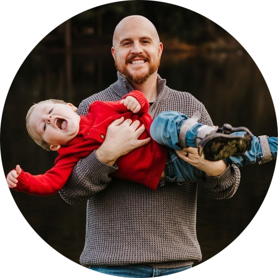

In this episode we are joined by Micah Heaton for a wide-ranging conversation about the difference between vibe coding and genuinely coding with AI. We break down how vibe coding (i.e the hope of a single natural-language prompt producing a finished product) differs from a more disciplined approach where you plan extensively, build markdown spec files, and iterate against a structured brief before writing a line of code. Micah shares hard-won lessons from building interactive red-vs-blue security experiences for Microsoft's global Innovation Hubs, including an honest account of how expensive and messy it got when he tried to build one prompt at a time in Replit without a plan, versus how much faster his current projects move now that he drafts and refines specs in Claude first. 

Nic introduces the idea of cognitive offload versus cognitive surrender, the critical distinction between using AI to accelerate your thinking and handing over every decision so you end up with something you don't understand and draws parallels all the way back to teaching PowerShell at TechEd while Chris rounds things out with the perspective of someone still deep in the planning phase who admits to midnight architecture conversations with Claude, arguing that years of troubleshooting and systems thinking give seasoned IT pros a real edge when it comes to getting value out of these tools.

Micah Heatonm is an award-winning Microsoft security strategist and Executive Director of Product and Innovation Strategy at BlueVoyant, where he works directly with Microsoft and partners to shape the future of the security stack. A Microsoft MVP in SIEM and XDR, 2025 Microsoft Security Changemaker, and Security Copilot pioneer, Micah helps organisations navigate the real-world challenges of modern security operations across Sentinel, Defender, Entra, and beyond. He's a speaker, writer, and advocate for the quiet defenders doing the hard work without recognition. Above all, he is a grateful husband, father, and mission-driven leader focused on making security simpler, stronger, and more human. You can connect with Micah on [LinkedIn](https://www.linkedin.com/in/micahheaton/)

### Supporting Micah's Family
Micah's wife Whitley is navigating a serious combination of neurological conditions, including CRPS and Psychogenic Non-Epileptic Seizures, and the family is pursuing international care to give her the best possible path forward. Micah didn't mention this on the show, but we wanted to share it here for anyone who'd like to help. If you're in a position to contribute or share, it would mean a lot. You can find more info on [GoFundMe](https://www.gofundme.com/f/help-whitley-get-to-italy-for-lifechanging-crps-treatment)

<iframe width="100%" height="300" scrolling="no" frameborder="no" allow="autoplay; encrypted-media" src="https://w.soundcloud.com/player/?url=https%3A//api.soundcloud.com/tracks/soundcloud%253Atracks%253A2349896762&color=%23ff5500&auto_play=false&hide_related=false&show_comments=true&show_user=true&show_reposts=false&show_teaser=true&visual=true"></iframe>

Prefer video? check us out on YouTube:

<iframe width="560" height="315" src="https://www.youtube.com/embed/cMxXNp11QA4?si=Vor_jqy7x_fSYcTU" title="YouTube video player" frameborder="0" allow="accelerometer; autoplay; clipboard-write; encrypted-media; gyroscope; picture-in-picture; web-share" referrerpolicy="strict-origin-when-cross-origin" allowfullscreen></iframe>

